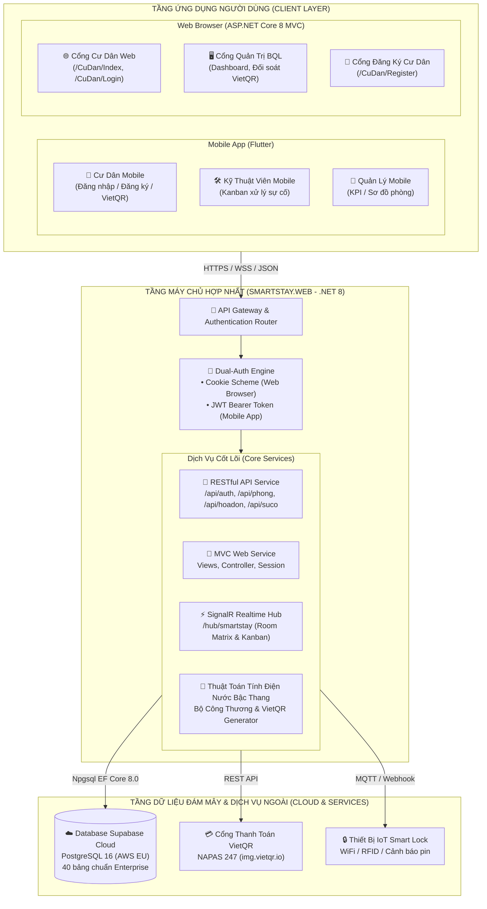
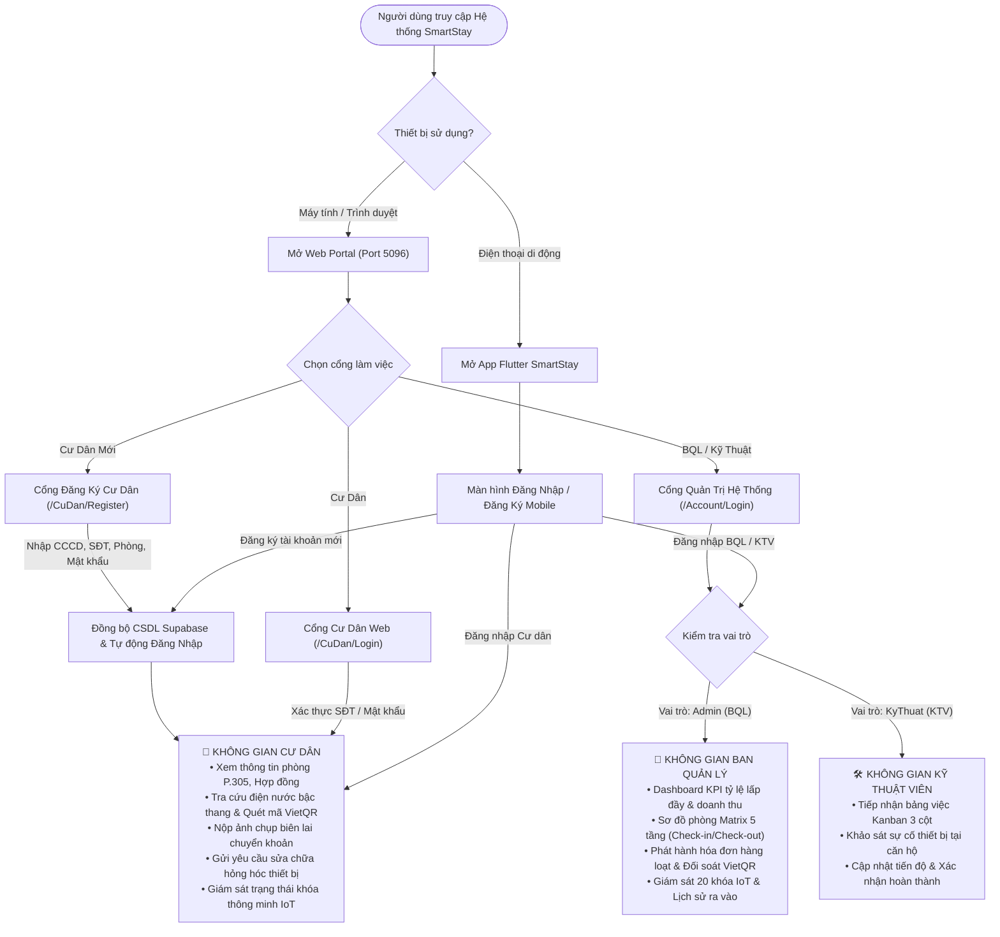

# SMARTSTAY – HỆ THỐNG QUẢN TRỊ HỆ SINH THÁI LƯU TRÚ THÔNG MINH ĐA NỀN TẢNG
## (Unified Web Portal, Resident Web, Mobile App & Supabase Cloud PostgreSQL)

> **Đồ án Chuyên ngành Công nghệ Thông tin / Kỹ thuật Phần mềm**  
> **Nhóm sinh viên thực hiện:**  
> • **Hồ Ngọc Bảo** (MSSV: `2380600133` - Trưởng nhóm)  
> • **Nguyễn Dương Bảo** (MSSV: `2380600154`)  
> • **Trần Hoàng Gia Bảo** (MSSV: `2380600178`)  
> 
> **Repository GitHub:** [https://github.com/Hongocbao/SmartStay](https://github.com/Hongocbao/SmartStay)

---

## 1. Sơ Đồ Cấu Trúc Thư Mục Dự Án

> Hướng dẫn deploy hai URL riêng trên Render, cấu hình secrets và ghi chú an toàn schema: [docs/DEPLOY_RENDER.md](docs/DEPLOY_RENDER.md).

Cấu trúc dự án được tinh gọn, tối ưu theo mô hình hợp nhất (**Unified Architecture**): gom Backend API và Web Portal vào `SmartStay.Web` để triển khai hosting mượt mà, dùng chung cơ sở dữ liệu đám mây **Supabase Cloud PostgreSQL**:

```
E:\DAN_ChuyenNganh
├── database/                                # CƠ SỞ DỮ LIỆU ĐÁM MÂY SUPABASE CLOUD
│   ├── schema_postgresql_supabase.sql       # Script khởi tạo 40 bảng PostgreSQL chuẩn hóa
│   └── upgrade_postgresql_supabase.sql      # Dữ liệu mẫu (Seed Data) & Bổ sung phân quyền
│
├── SmartStay/                               # ỨNG DỤNG DI ĐỘNG FLUTTER (ANDROID STUDIO)
│   ├── lib/
│   │   ├── models/                          # Data Models (User, Room, Ticket, Invoice, IoT, Contract...)
│   │   ├── providers/                       # State Management (Auth, Admin, Ticket, Invoice, AI Chat...)
│   │   ├── screens/
│   │   │   ├── auth/                        # Đăng nhập đa vai trò & Đăng ký Cư dân mới
│   │   │   ├── home/                        # Trang chủ Cư dân P.305 (Hồ Ngọc Bảo)
│   │   │   ├── invoice/                     # Chi tiết hóa đơn bậc thang & VietQR NAPAS 247
│   │   │   ├── ticket/                      # Báo hỏng thiết bị 3 bước, đánh giá 5★
│   │   │   ├── community/                   # Bảng tin nội khu & Sự kiện cộng đồng
│   │   │   ├── profile/                     # Hợp đồng điện tử & Danh mục tài sản bàn giao
│   │   │   ├── ai_chat/                     # Trợ lý ảo AI Gemini 24/7 hỗ trợ cư dân
│   │   │   └── admin/                       # Phân hệ Quản trị & Kỹ thuật viên (Matrix, Kanban, IoT)
│   │   ├── services/                        # ApiService (kết nối Web API cổng 5096) & MockDataService
│   │   └── utils/                           # Formatters (VNĐ, ngày giờ, trạng thái)
│   └── pubspec.yaml
│
├── SmartStay.Web/                           # HỆ SINH THÁI HỢP NHẤT WEB & BACKEND API (.NET 8)
│   ├── Controllers/
│   │   ├── AccountController.cs             # Đăng nhập Phân quyền, Cổng Đăng Nhập & Đăng Ký Cư Dân
│   │   ├── CuDanController.cs               # Cổng Dịch Vụ Cư Dân trên Web (Phòng, Hóa đơn, Báo hỏng)
│   │   ├── HomeController.cs                # Dashboard KPI Ban Quản Lý
│   │   ├── PhongController.cs               # Sơ đồ phòng Matrix & Quản lý phòng
│   │   ├── SuCoController.cs                # Kanban điều phối sự cố kỹ thuật
│   │   ├── HoaDonController.cs              # Hóa đơn bậc thang, đối soát VietQR
│   │   └── AllApiControllers.cs             # Core REST API: /api/auth, /api/phong, /api/hoadon, /api/suco
│   ├── Views/
│   │   ├── Account/                         # Giao diện Đăng nhập hệ thống, Cổng Cư Dân, Cổng Đăng Ký
│   │   ├── CuDan/                           # Giao diện Cổng Cư Dân Web (Tổng quan, Hóa đơn, Sự cố)
│   │   ├── Home/, Phong/, SuCo/, HoaDon/    # Giao diện Quản trị viên
│   │   └── Shared/_Layout.cshtml            # Bố cục giao diện Responsive đa vai trò
│   ├── Data/SmartStayDbContext.cs           # EF Core kết nối Supabase Cloud PostgreSQL
│   ├── Hubs/SmartStayHub.cs                 # SignalR Realtime Hub cho Room Matrix & Kanban
│   ├── Services/                            # TokenService (JWT), InvoiceCalculationService (Bậc thang)
│   ├── Program.cs                           # Dual-Auth (Cookie Web + Bearer JWT API), Swagger UI, CORS
│   └── appsettings.json                     # ConnectionString Supabase PostgreSQL Cloud
│
└── SmartStay.sln                            # File Solution Visual Studio duy nhất mở toàn bộ dự án
```

---

## 2. Sơ Đồ Kiến Trúc Hệ Thống (System Architecture Diagram)

Hệ thống hoạt động theo mô hình Client - Server kết hợp Đa nền tảng và Điện toán đám mây:



---

## 3. Sơ Đồ Phân Quyền & Luồng Nghiệp Vụ (RBAC Flowchart)

Hệ thống hỗ trợ 3 phân hệ người dùng chính với cơ chế phân quyền chặt chẽ trên cả Web và Mobile:



---

## 4. Cơ Sở Dữ Liệu Supabase Cloud PostgreSQL

- **Nền tảng:** Supabase Cloud (PostgreSQL 16)
- **Host:** `aws-1-eu-west-3.pooler.supabase.com` - **Port:** `5432` - **Database:** `postgres`
- **Quy mô:** **40 bảng quan hệ chuẩn hóa 3NF**
  - **Nhóm Lưu trú & Phòng:** `ToaNha`, `Tang`, `LoaiPhong`, `Phong`, `Giuong`, `TienNghi`, `HopDong`, `CuDanHopDong`, `BienBanBanGiao`.
  - **Nhóm Cư dân & Tài khoản:** `NguoiDung`, `VaiTro`, `CuDan`, `KhachLuuTru`, `PhuongTienCuDan`, `MaDatLaiMatKhau`.
  - **Nhóm Tài chính & VietQR:** `HoaDon`, `ChiTietHoaDon`, `BieuGiaDien`, `BieuGiaNuoc`, `ThanhToan`, `SoQuyThuChi`, `ViCuDan`, `LichSuGiaoDichVi`.
  - **Nhóm Sự cố & Kỹ thuật:** `PhieuSuCo`, `LichSuSuCo`, `HinhAnhSuCo`, `TraoDoiSuCo`, `VatTu`, `SuDungVatTu`.
  - **Nhóm IoT Smart Lock:** `ThietBiThongBao`, `LichSuTruyCapCua`.
  - **Nhóm Tiện ích & Cộng đồng:** `ThongBao`, `SuKien`, `DangKySuKien`, `PhienTroChuyen`, `TinNhanTroChuyen`.
- **Dữ liệu mẫu chuẩn bị sẵn (Seed Data):**
  - 3 tài khoản cư dân mẫu của sinh viên: `2380600133` (Hồ Ngọc Bảo - P.305), `2380600154` (P.201), `2380600178` (P.401).
  - Tài khoản Quản lý: `admin` / Mật khẩu `123456`.
  - Tài khoản Kỹ thuật: `kythuat` / Mật khẩu `123456`.

---

## 5. Hướng Dẫn Cài Đặt & Chạy Hệ Thống

### 1. Khởi chạy Web Portal & REST API (.NET 8)
```powershell
cd E:\DAN_ChuyenNganh\SmartStay.Web
dotnet run
```
- **Cổng Quản Trị Hệ Thống:** `http://localhost:5096/Account/Login`
- **Cổng Dịch Vụ Cư Dân:** `http://localhost:5096/CuDan/Login`
- **Cổng Đăng Ký Cư Dân Mới:** `http://localhost:5096/CuDan/Register`
- **Tài liệu Swagger API:** `http://localhost:5096/swagger`

### 2. Khởi chạy Ứng dụng Di động Flutter (Android Studio)
1. Mở **Android Studio** -> Chọn **Open** thư mục: `E:\DAN_ChuyenNganh\SmartStay`.
2. Đợi Gradle đồng bộ thư viện hoàn tất.
3. Chọn thiết bị đích (**Android Emulator** hoặc **Chrome Web**).
4. Bấm nút **Run ▶** (hoặc `Shift + F10`).
5. Ứng dụng tự động kết nối Backend API tại `http://10.0.2.2:5096/api` (trên máy ảo) hoặc `http://localhost:5096/api` (trên máy thật).

---

## 6. Tổng Kết Trạng Thái Kỹ Thuật

- ✅ **CSDL:** 40 bảng đã nạp thành công lên **Supabase Cloud PostgreSQL** và hoạt động ổn định.
- ✅ **Backend & Web:** Biên dịch đạt chuẩn `Build succeeded: 0 Warning, 0 Error`.
- ✅ **Cổng Cư Dân Độc Lập:** Hỗ trợ cư dân truy cập trên trình duyệt không cần cài app, tích hợp mã VietQR và nộp biên lai.
- ✅ **Cổng Đăng Ký Cư Dân:** Cho phép cư dân mới tạo tài khoản, mã hóa BCrypt và tự động phân quyền.
- ✅ **Mobile App Flutter:** Đạt chuẩn `No issues found!`, hỗ trợ chuyển đổi vai trò 1-chạm mượt mà.
- ✅ **Đồng bộ mã nguồn:** Cập nhật liên tục tại GitHub `https://github.com/Hongocbao/SmartStay`.
